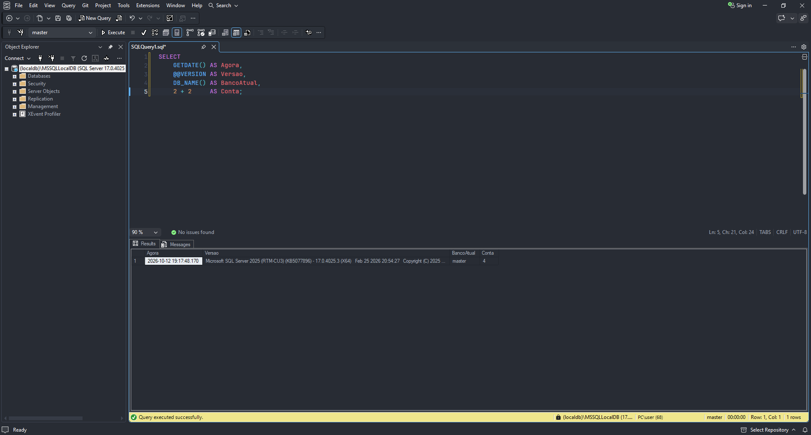

<div align="center">
  <h1 align="center">One Dark Pro (SSMS)</h1>
  <p align="center">One Dark Pro theme for SQL Server Management Studio 22 (unofficial port)</p>
  <a href="https://learn.microsoft.com/ssms/"></a>
  <a href="https://github.com/Binaryify/OneDark-Pro"></a>
  <a href="LICENSE"></a>
  <a href="../../releases/latest"></a>
  <a href="../../releases/latest/download/one-dark-pro-ssms.zip"></a>
  <br><br>
  <b>English</b> · <a href="README.pt-BR.md">Português (Brasil)</a>
</div>

<br>

<p align="center">
  
</p>

The Visual Studio version of [One Dark Pro](https://github.com/Binaryify/OneDark-Pro) loads in
SSMS 22, but leaves menus, toolbars and Object Explorer in plain black and gray. This port fills
those gaps and tunes the T-SQL colors to the One Dark palette.

> Unofficial port, not affiliated with the original author. Report issues here.

## Install

Requires SSMS 22 on Windows 10 or 11.

1. Download [`one-dark-pro-ssms.zip`](../../releases/latest/download/one-dark-pro-ssms.zip) and extract it.
2. Double-click `Install.cmd` and accept the administrator prompt.
   If Windows warns about the file, click **More info → Run anyway**.
3. Restart SSMS and go to **Tools → Options → Environment → Visual Experience → One Dark Pro (SSMS)**.

## Uninstall

If anything goes wrong, double-click `Uninstall.cmd`. SSMS falls back to a built-in theme on
next launch.

<details>
<summary><b>Recommended font and zoom</b></summary>

<br>

In **Tools → Options → Environment → Fonts and Colors**:

- **Text Editor:** `JetBrainsMono NFM`, size 12 ([Nerd Fonts](https://www.nerdfonts.com/font-downloads), installed for all users)
- **Text Results** and **Grid Results:** the same font, size 11 or 12, so the Messages and Results tabs match

Set the editor zoom to **91%** instead of 100%: glyphs render rounder and easier on the eyes.

</details>

<details>
<summary><b>Updating</b></summary>

<br>

**New theme version:** download the new zip and run `Install.cmd` again, no need to uninstall.

**New SSMS version:** if some area turns black or gray again, the update shipped new colors.
Clone this repository and rebuild the theme from the installed SSMS:

```powershell
.\scripts\Build-Theme.ps1
.\scripts\Install.ps1
```

</details>

<details>
<summary><b>How the port works</b></summary>

<br>

SSMS 22 runs on the Visual Studio 2026 shell, whose color categories (`Shell`, `ShellInternal`...)
the original theme doesn't define. `Build-Theme.ps1` copies them from the Dark theme, swaps the
neutral grays for One Dark tones (`#21252B`, `#282C34`, `#2C313A`, `#3E4452`) and the purple
accent for `#61AFEF`, and sets the SSMS-only T-SQL items:

| Item | Color |
| :-- | :-- |
| SQL String | `#98C379` |
| SQL System Function / Stored Procedure | `#61AFEF` |
| SQL System Table | `#E5C07B` |
| SQL Operator | `#56B6C2` |

The theme has its own name and GUID, so it never collides with the original extension.

```
one-dark-pro-ssms.pkgdef        the ready-to-use theme
Install.cmd / Uninstall.cmd     double-click entry points
original/                       One Dark Pro for Visual Studio, generator input
scripts/Build-Theme.ps1         builds the SSMS theme from the original
scripts/Build-Release.ps1       packages the release zip into dist/
scripts/Install.ps1             finds SSMS through vswhere and copies the theme
scripts/Uninstall.ps1           removes the theme
scripts/ThemeTool.ps1           reads/writes the binary color format of .pkgdef files
scripts/Ssms.ps1                shared helpers
```

</details>

## License

MIT. The colors come from One Dark Pro (© Binaryify, see `original/LICENSE.txt`); the scripts
and the SSMS port belong to this repository.
